# Service Desk 8x8 Assistant — Prototype

See phone coverage, keep call notes and get reminders to finish wrap-up or return from lunch.

This is a **JavaScript prototype** that runs in your 8x8 page.

**Author:** Joshua Lavagna-Slater · **Prototype version:** 1.2.1

[Prototype code](Service-Desk-8x8-Assistant.js) · [Download release](https://github.com/JModify/bond-8x8-assistant/releases/tag/v1.2.1) · [Technical guide](TECHNICAL.md) · [Release notes](CHANGELOG.md)

## Future direction

The goal is an **organisation-approved Microsoft Edge extension** that:

- **Starts automatically** when you open 8x8, without manually running the assistant each session.
- **Keeps Call Notes and settings across browser sessions**, so your call history is still there when you reopen Edge.

The extension package is currently for development and testing, pending approval for team deployment.

## Prototype setup

Choose either launch method. Both run the same assistant.

### Bookmark Prototype

**Recommended.** Start the assistant with one click from Edge’s favourites bar.

1. [Download the bookmark installer (.html)](https://github.com/JModify/bond-8x8-assistant/releases/download/v1.2.1/Service-Desk-8x8-Assistant-Bookmark-1.2.1.html).
2. Open the downloaded file in **Microsoft Edge**. Press **Ctrl+Shift+B** to show the favourites bar.
3. Drag **8x8 Assistant** onto the bar. The file also includes an import option.
4. Open your signed-in **8x8 tab**, then click the saved **8x8 Assistant** favourite.

After refreshing or reopening 8x8, click the favourite again. Replace it with the new download when updating.

### DevTools Script Prototype

Save an editable copy in Edge’s DevTools and run it from the Snippets menu.

1. [Download the JavaScript file (.js)](https://github.com/JModify/bond-8x8-assistant/releases/download/v1.2.1/Service-Desk-8x8-Assistant-Prototype-1.2.1.js). Open it in **Notepad** and copy all the code.
2. Open your signed-in **8x8 tab** and press **Ctrl+Shift+I**.
3. Open **Sources**. If it is hidden, click **+** and choose **Sources**.

   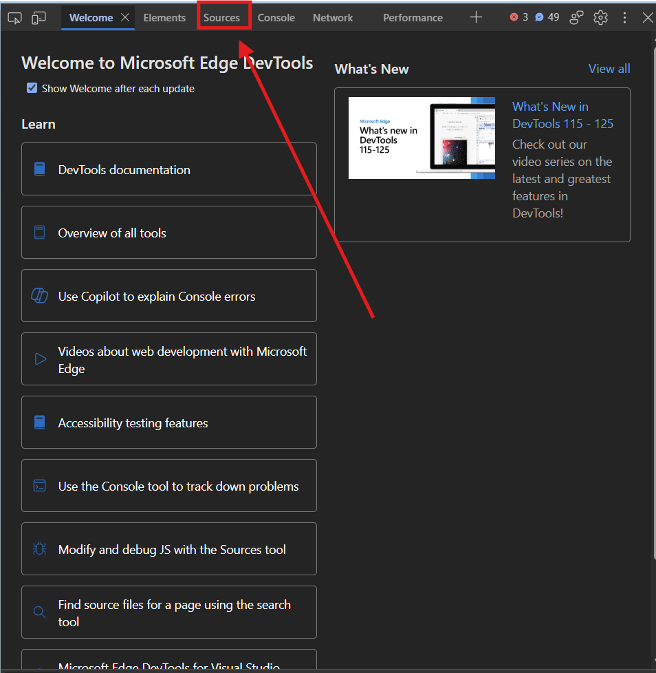

4. Click **» → Snippets**, then **New snippet**.

   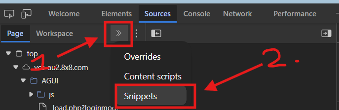

5. Name it **8x8 Assistant**, paste the code, press **Ctrl+S**, then **Ctrl+Enter**.

After refreshing or reopening 8x8, open the saved snippet and press **Ctrl+Enter** again.

### Configure 8x8 — both methods

1. Open **queue information** using the button to the right of your status, next to the bell icon.

   <a href="docs/images/queue-info.png">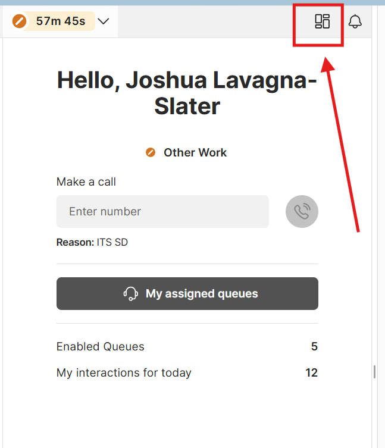</a>

2. Under **Groups → Filter**, select **ITS**, tick **every User status**, and leave **Show only favorite agents** off.

   | Group: select ITS | User status: tick every status |
   | --- | --- |
   | <a href="docs/images/filter-group.png">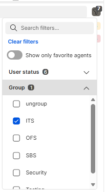</a> | <a href="docs/images/filter-user-status.png">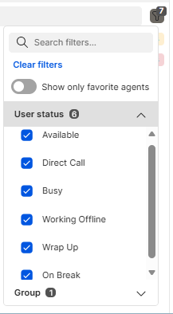</a> |

3. Keep **ITS Academic Hotline**, **ITS Internal TRNFR** and **ITS Service Desk** visible in the queue list.
4. Tick **G1** for agents covering phones, including **Me** when you are covering phones. Unticked agents are **G2**.

**Optional auto-save:** open **Settings → Data location → Choose data file**, choose a TXT file and allow access. The assistant reconnects and restores Call Notes when it starts. Edge may ask for access again on your next click in 8x8; **Reconnect** remains available in Settings.

## Assistant views

The view changes automatically as you take calls, wrap up or go on break. Click an image to enlarge it. Example images show v1.1.3 with personal details blacked out.

| View | What you can do |
| --- | --- |
| **Main assistant** <a href="docs/images/main-view.png">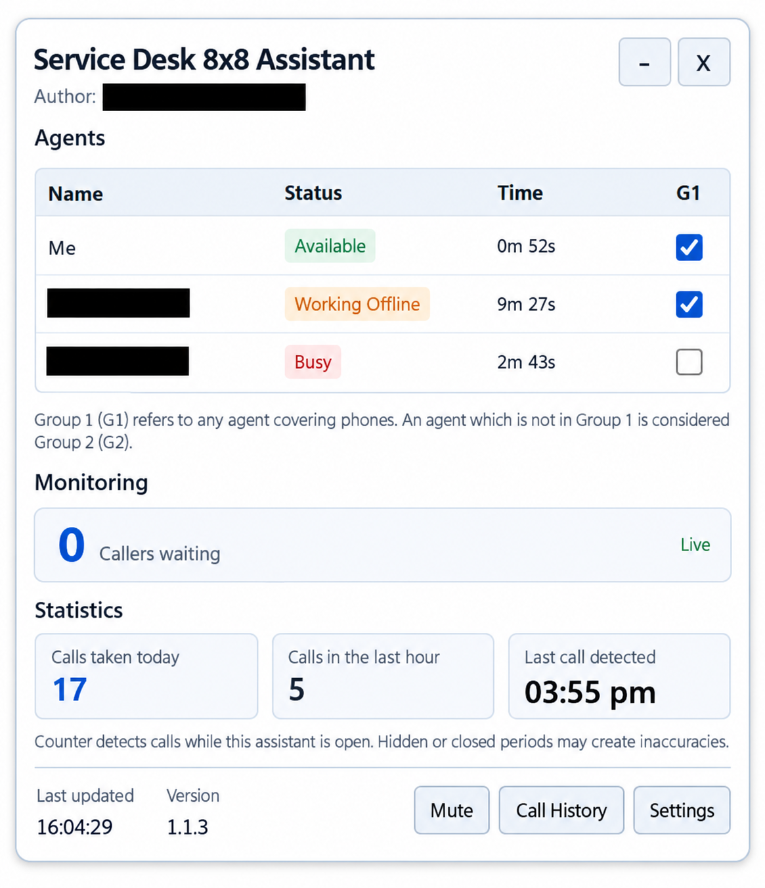</a> | View agents, statuses, timers, G1 roles and a combined waiting total. See today's call count, calls in the last hour and the last call. Clear alerts explain when phone cover is needed. Missing information freezes the agent table with a **Last read** badge; the assistant stays open. |
| **On a call** <a href="docs/images/on-call-view.png">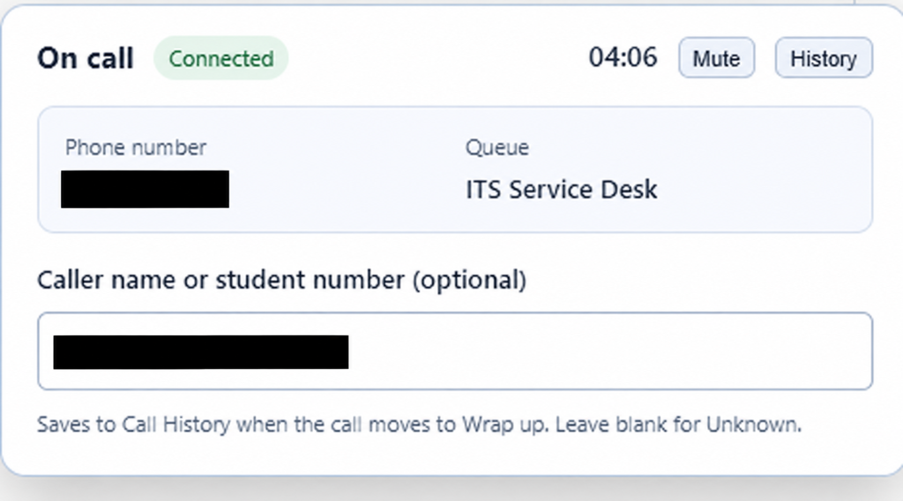</a> | See caller number, queue, duration and hold status. Enter a name, username or student number and optional notes; they save at **Wrap up**. Blank names become **Unknown**. |
| **Call Notes** <a href="docs/images/call-history-view.png">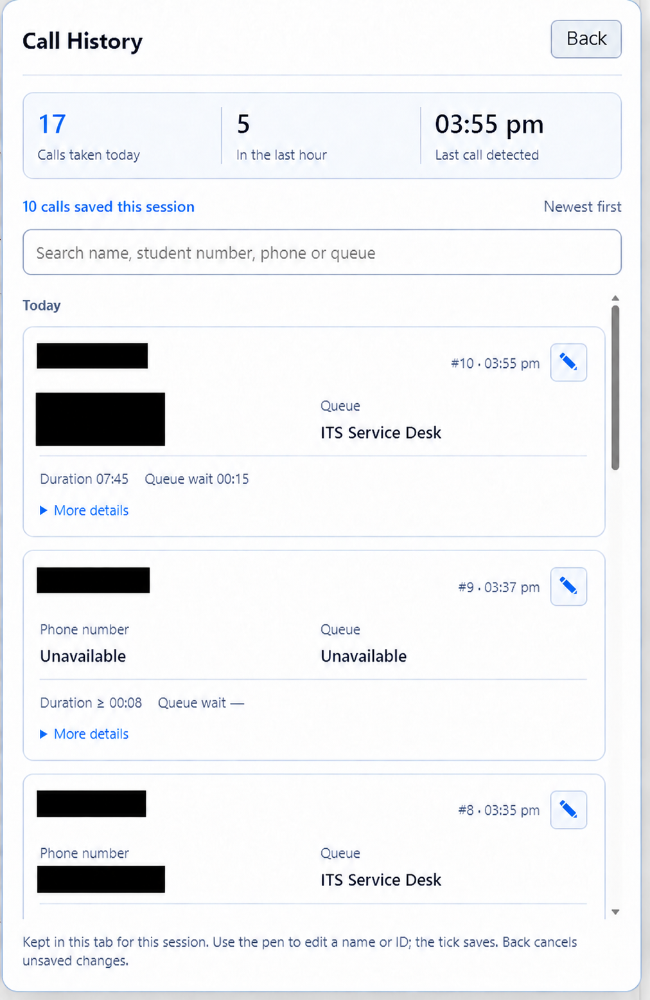</a> | Use **+ Add note** for in-person visits. Search names, notes and job numbers; see totals for saved notes, predicted students/staff and missing jobs. The **pen** edits a record; the **tick**, clicking away or **Back** saves. Delete with the **bin**, with **Undo** available. |
| **Lunch break** <a href="docs/images/lunch-view.png">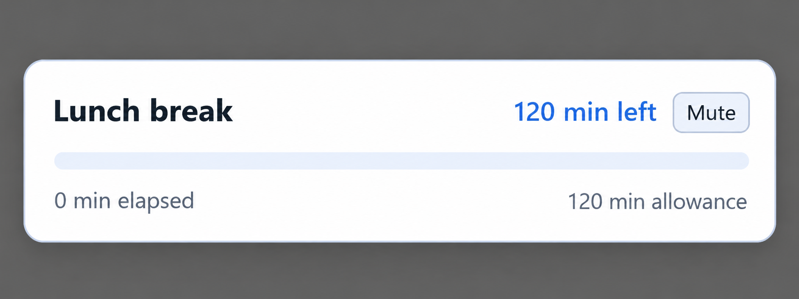</a> | See elapsed and remaining minutes, with a reminder when your configured lunch length is exceeded. |
| **Short break** <a href="docs/images/short-break-view.png">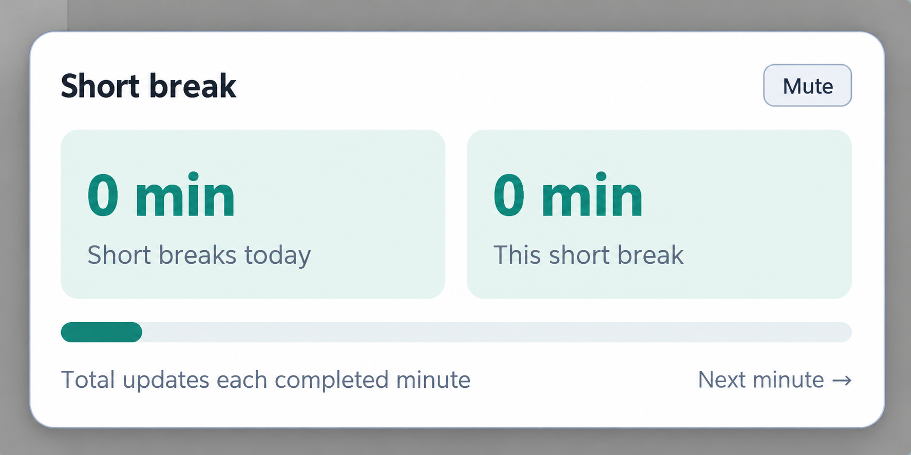</a> | Track this break and today's total in completed minutes. Short breaks are counted separately from lunch. |
| **Disposition** <a href="docs/images/disposition-view.png">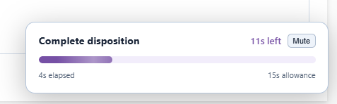</a> | See your countdown and get a reminder to complete the fields and click **Wrap up**. Lunch and disposition reminders work in both groups. |

## Controls and customisation

- **Resize:** drag the assistant’s top-left corner. Double-click it to restore the default size.
- **Speaker icon:** mute or unmute sounds while monitoring and counting continue. **Call Notes** sits to the left of the icons.
- **Call Notes → Export TXT / Import TXT:** save a readable Notepad file or bring saved notes back. Export lets you choose a location where Edge allows it; otherwise it downloads the file. Import adds notes and skips records already present.
- **Gear icon → Settings:** choose a data file, change lunch length, reminder delays and notifications.
- **Sound Settings:** choose sounds, volume, duration, repeat and per-sound notifications. Select an output device or enable **Secondary Ringer** for a second device.
- **– / ×:** minimise or close the assistant. It never changes your status or answers calls for you.

## Quick help

- **Agent information frozen:** open 8x8 queue information and check the setup filters. Last-read statuses and times stay visible until live data returns. **Call Notes** and settings remain available.
- **Queue data unavailable:** scroll back to the three monitored queues for live waiting counts.
- Keep 8x8 open. The counter can miss calls when the assistant is unavailable. Connect a data file or export Call Notes before ending your tab session. A crash or power loss can interrupt the latest save.
- **Data file needs attention:** open Settings to reconnect or choose another file. Recovered unfinished notes have a **Recovered** label. Importing or deleting notes does not change the call counter.
- For notification setup and detailed behaviour, see the [technical guide](TECHNICAL.md).
